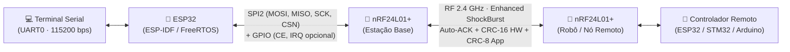
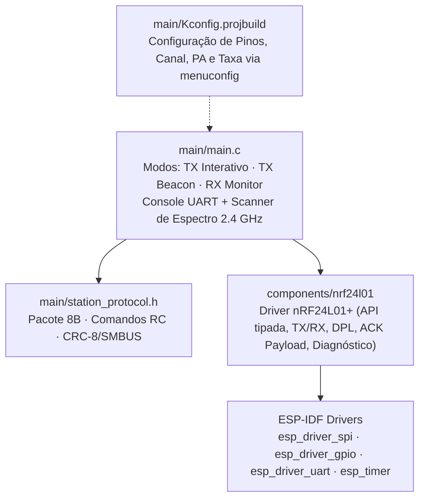

# 📡 ESP32 Station — Driver e Estação RF nRF24L01+

<p align="center">
  
  
  
  
  
</p>

> **Estação base sem fio baseada em ESP32 + nRF24L01+ em C (ESP-IDF)** com componente de driver completo, protocolo binário com verificação CRC-8, console serial interativo, scanner de espectro 2.4 GHz e suíte de testes unitários em host.

---

## 📑 Índice

- [Visão Geral](#-visão-geral)
- [Arquitetura do Sistema](#-arquitetura-do-sistema)
- [Hardware e Pinagem](#-hardware-e-pinagem)
- [Estrutura do Repositório](#-estrutura-do-repositório)
- [Modos de Operação](#-modos-de-operação)
- [Como Compilar e Gravar](#-como-compilar-e-gravar)
- [Console Interativo e Scanner RF](#-console-interativo-e-scanner-rf)
- [Testes Unitários (Host / Mock SPI)](#-testes-unitários-host--mock-spi)
- [Documentação Técnica Detalhada](#-documentação-técnica-detalhada)
- [Solução de Problemas (Troubleshooting)](#-solução-de-problemas-troubleshooting)
- [Licença](#-licença)

---

## 🎯 Visão Geral

O **ESP32 Station** é um firmware modular para **ESP-IDF** que implementa:

1. **Driver `nrf24l01` completo e aderente ao datasheet** ([`components/nrf24l01`](components/nrf24l01)):
   - Transações SPI **únicas full-duplex** com CSN gerenciado por hardware (sem glitches entre comando e payload).
   - Suporte a **Enhanced ShockBurst** (Auto-ACK, retransmissão configurável, 6 pipes RX, payloads dinâmicos e ACK Payloads).
   - Enums tipados para taxa de dados (`250 kbps`, `1 Mbps`, `2 Mbps`), potência PA (`-18` a `0 dBm`), CRC e largura de endereço.
   - Autodiagnóstico de hardware (`nrf24_is_connected`), estatísticas de enlace (`TX_OK`, `MAX_RT`, `TIMEOUT`, `RX`), leitura de `OBSERVE_TX` e detecção de portadora (`RPD`).
2. **Protocolo de comunicação estruturado** ([`main/station_protocol.h`](main/station_protocol.h)):
   - Quadros binários fixos de **8 bytes** com cabeçalho (`0xA5`), versionamento, número sequencial (`seq`) para detecção de perda e integridade via **CRC-8/SMBUS**.
3. **Aplicação configurável via `menuconfig`** ([`main/Kconfig.projbuild`](main/Kconfig.projbuild)):
   - Três modos prontos para uso: **TX Interativo (RC + Scanner RF)**, **TX Beacon Periódico** e **RX Monitor**.

---

## 🏗️ Arquitetura do Sistema

### Enlace Físico e RF



### Camadas de Software



---

## 🔌 Hardware e Pinagem

Pinagem padrão (editável em `idf.py menuconfig → ESP32 Station Configuration → Pinagem SPI`):

| Sinal nRF24L01+ | Pino ESP32 (Padrão) | Função | Observação |
| :---: | :---: | :--- | :--- |
| **VCC** | `3V3` | Alimentação 3.3 V | **Nunca ligar em 5 V!** Usar capacitor `10 µF` + `100 nF` próximo ao módulo |
| **GND** | `GND` | Referência comum | Manter fios curtos |
| **CE** | `GPIO 4` | Chip Enable (TX/RX) | Controlado via GPIO pelo driver |
| **CSN** | `GPIO 5` | Chip Select SPI (ativo baixo) | Controlado automaticamente pelo periférico SPI2 |
| **SCK** | `GPIO 18` | Clock SPI (VSPI/SPI2) | Padrão `1 MHz` (suporta até `10 MHz`) |
| **MOSI** | `GPIO 23` | Master Out Slave In | Dados ESP32 → nRF24L01+ |
| **MISO** | `GPIO 19` | Master In Slave Out | Dados nRF24L01+ → ESP32 |
| **IRQ** | `Não conectado (-1)` | Interrupção (ativo baixo) | Opcional — configurável via `menuconfig` |

> [!WARNING]
> **Estabilidade de alimentação:** Módulos nRF24L01+ (especialmente versões com amplificador **PA+LNA**) consomem picos de corrente durante a transmissão que derrubam reguladores 3.3 V fracos. Solde um capacitor eletrolítico de **10 µF** (ou 47 µF) em paralelo com um cerâmico de **100 nF** diretamente nos pinos **VCC** e **GND** do módulo.

Mais detalhes elétricos e mapa completo de registradores em [docs/HARDWARE.md](docs/HARDWARE.md).

---

## 📁 Estrutura do Repositório

```text
esp32-station/
├── .devcontainer/                 # Ambiente Docker pronto com ESP-IDF
├── .github/workflows/             # CI automático (compilação estrita + testes unitários)
├── components/
│   └── nrf24l01/
│       ├── CMakeLists.txt
│       ├── include/nrf24l01.h     # API pública, enums, structs e mapa de registradores
│       └── src/nrf24l01.c         # Implementação do driver SPI/RF
├── docs/
│   ├── API.md                     # Referência completa da API do driver
│   ├── HARDWARE.md                # Esquema elétrico, timing SPI e tabela de registradores
│   └── PROTOCOL.md                # Especificação do protocolo binário e fluxo ESB
├── main/
│   ├── CMakeLists.txt
│   ├── Kconfig.projbuild          # Menu de configuração (idf.py menuconfig)
│   ├── station_protocol.h         # Pacote de 8 bytes, comandos e CRC-8
│   └── main.c                     # Aplicação (TX Interativo, TX Beacon, RX Monitor)
├── test/
│   ├── Makefile                   # Atalho para executar os testes em host
│   ├── mocks/                     # Headers mock do ESP-IDF para compilação nativa
│   ├── mock_nrf24_hw.h/.c         # Simulador stateful de hardware nRF24L01+
│   └── test_nrf24l01.c            # Suíte de testes unitários (driver + protocolo)
├── CMakeLists.txt
├── LICENSE
└── README.md
```

---

## ⚙️ Modos de Operação

Selecione o papel da placa em `idf.py menuconfig → ESP32 Station (nRF24L01+) Configuration`:

| Modo (`Kconfig`) | Descrição | Caso de Uso |
| :--- | :--- | :--- |
| **`TX Interativo`** *(padrão)* | Lê comandos do teclado via UART0, transmite pacotes com Auto-ACK, mede latência (`P`) e executa scanner 2.4 GHz (`C`) | Controle remoto de robô/rover e diagnóstico de bancada |
| **`TX Beacon Periódico`** | Envia pacotes `STATION_CMD_BEACON` em intervalo configurável e imprime taxa de entrega (%) | Teste de alcance, antena e estabilidade de enlace |
| **`RX Monitor`** | Escuta o Pipe 0 continuamente, valida `magic` + `CRC-8`, detecta pacotes perdidos via `seq` e exibe telemetria | Segunda ESP32 atuando como receptor ou sniffer de validação |

---

## 🚀 Como Compilar e Gravar

### Pré-requisitos

- **ESP-IDF v5.3 ou superior** instalado localmente, **ou**
- **VS Code + Dev Containers** (o projeto já inclui `.devcontainer/` baseado em `espressif/idf:latest`).

### Passo a passo

```bash
# 1. Clone o repositório
git clone https://github.com/Paludeto/esp32-station.git
cd esp32-station

# 2. Defina o alvo ESP32
idf.py set-target esp32

# 3. (Opcional) Ajuste modo TX/RX, canal RF, pinos e potência
idf.py menuconfig

# 4. Compile o firmware
idf.py build

# 5. Grave na placa e abra o monitor serial (substitua COM3 ou /dev/ttyUSB0)
idf.py -p COM3 flash monitor
```

> [!TIP]
> O canal padrão é **2 (2402 MHz)** com endereço `00:00:00:00:01` para manter compatibilidade com receptores já configurados. Em ambientes com muitas redes Wi-Fi, mude `STATION_RF_CHANNEL` para um canal entre **76 e 125** (`2476–2525 MHz`) — use o comando `C` no console interativo para escolher o canal mais limpo!

---

## 🖥️ Console Interativo e Scanner RF

No modo **TX Interativo**, conecte-se à porta serial (`115200 bps`) e utilize os comandos abaixo:

| Tecla | Ação | Pacote / Comportamento |
| :---: | :--- | :--- |
| `W` / `S` / `A` / `D` | Frente / Ré / Esquerda / Direita | Envia `STATION_CMD_*` com a velocidade atual |
| `X` | Parar (`STOP`) | Envia `STATION_CMD_STOP` com `speed = 0` |
| `+` / `-` | Aumentar / Diminuir velocidade | Ajusta `speed` (`0..255`) em passos de `25` |
| `P` | Ping RF | Envia `STATION_CMD_PING` e mede RTT (TX + Auto-ACK) em µs |
| `I` | Inspeção e estatísticas | Exibe dump de registradores, `OBSERVE_TX` e contadores |
| `C` | **Scanner 2.4 GHz** | Varre canais `0..125` usando `RPD` e sugere o canal livre |
| `H` ou `?` | Ajuda | Reimprime o menu de comandos |

### Exemplo de saída no Monitor Serial

```text
I (312) STATION: Iniciando ESP32 Station (nRF24L01+)...
I (330) NRF24: nRF24L01+ inicializado (CH=2, 2402 MHz, SPI=1000000 Hz)
I (332) NRF24: ================ nRF24L01+ Status ================
I (335) NRF24: STATUS      = 0x0E (RX_DR=0 TX_DS=0 MAX_RT=0 RX_P_NO=7 TX_FULL=0)
I (339) NRF24: CONFIG      = 0x0E (PWR_UP=1 PRIM_RX=0 CRC=2B)
I (343) NRF24: RF_CH       = 2 (2402 MHz)
I (346) NRF24: RF_SETUP    = 0x06 (Rate=1 Mbps, PA=0 dBm)
I (350) NRF24: TX_ADDR     = 00:00:00:00:01
I (353) NRF24: ==================================================
I (2410) STATION: TX OK -> FORWARD  | seq=0 | speed=180 | 842 us (arc=0)
I (3125) STATION: PONG seq=1 | RTT=796 us | retries=0
```

---

## 🧪 Testes Unitários (Host / Mock SPI)

O driver e o protocolo podem ser compilados e testados **diretamente no PC com GCC**, sem hardware físico, através de um simulador stateful do nRF24L01+ em [`test/`](test):

```bash
# Via Make (Linux / macOS / MSYS2)
make -C test

# Ou diretamente com GCC (Windows PowerShell / Bash)
gcc -std=c11 -Wall -Wextra -Werror -Wpedantic \
    -Icomponents/nrf24l01/include -Imain -Itest/mocks -Itest \
    components/nrf24l01/src/nrf24l01.c test/mock_nrf24_hw.c test/test_nrf24l01.c \
    -o test/build/test_nrf24l01 && ./test/build/test_nrf24l01
```

A suíte valida:
- Inicialização/desinicialização, gerenciamento exclusivo de CSN via SPI HW e tempo `Tpd2stby`.
- Detecção de desconexão SPI (`nrf24_is_connected` com MISO preso em `0x00`/`0xFF`).
- Codificação de canal (`0..125`), taxa (`250k/1M/2M`), potência PA, CRC, largura de endereço e retransmissões.
- Pipes RX (`P0–P1` com 5 bytes, `P2–P5` com 1 byte LSB) e restauração automática de `RX_ADDR_P0` nas trocas `TX ↔ RX`.
- Transmissão `TX_DS`, tratamento de `MAX_RT` (com `FLUSH_TX`), timeout, recepção multi-byte, payloads dinâmicos (inclusive flush automático para largura > 32 bytes), ACK payloads e validação **CRC-8** do protocolo.

---

## 📚 Documentação Técnica Detalhada

| Documento | Conteúdo |
| :--- | :--- |
| **[docs/API.md](docs/API.md)** | Referência completa de tipos, enums, funções e exemplos de código TX/RX/ACK Payload |
| **[docs/HARDWARE.md](docs/HARDWARE.md)** | Guia elétrico, desacoplamento, temporizações do datasheet e mapa de registradores (`0x00`–`0x1D`) |
| **[docs/PROTOCOL.md](docs/PROTOCOL.md)** | Layout byte a byte de `station_packet_t`, tabela de comandos, CRC-8/SMBUS e diagrama de sequência ESB |

---

## 🔧 Solução de Problemas (Troubleshooting)

| Sintoma | Causa Provável | Solução |
| :--- | :--- | :--- |
| `Modulo nRF24L01+ NAO detectado no barramento SPI!` | Fios `MISO`/`MOSI` trocados, `CSN`/`SCK` soltos ou módulo sem alimentação | Revise a tabela de pinagem e meça `3.3 V` diretamente nos pinos do módulo |
| `MAX_RT atingido (sem ACK do receptor)` | Receptor desligado, canal diferente, endereço diferente ou `Auto-ACK` incompatível | Confirme canal (`RF_CH`), taxa (`RF_SETUP`), tamanho do payload (`8 B`) e endereço `00:00:00:00:01` nos dois lados |
| Alcance muito curto ou quedas intermitentes | Interferência Wi-Fi no canal 2 ou ruído na alimentação 3.3 V | Adicione capacitor `10 µF + 100 nF` no VCC/GND e use o scanner (`C`) para migrar para um canal `>= 76` |
| Módulo PA+LNA não transmite à curta distância | Saturação do receptor em `0 dBm` com antenas coladas | Afaste os módulos (> 1 m) ou reduza a potência para `NRF24_PA_MIN` / `NRF24_PA_LOW` em testes de bancada |

---

## 📄 Licença

Distribuído sob a licença **MIT**. Consulte o arquivo [LICENSE](LICENSE) para mais detalhes.
