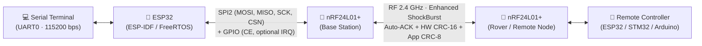
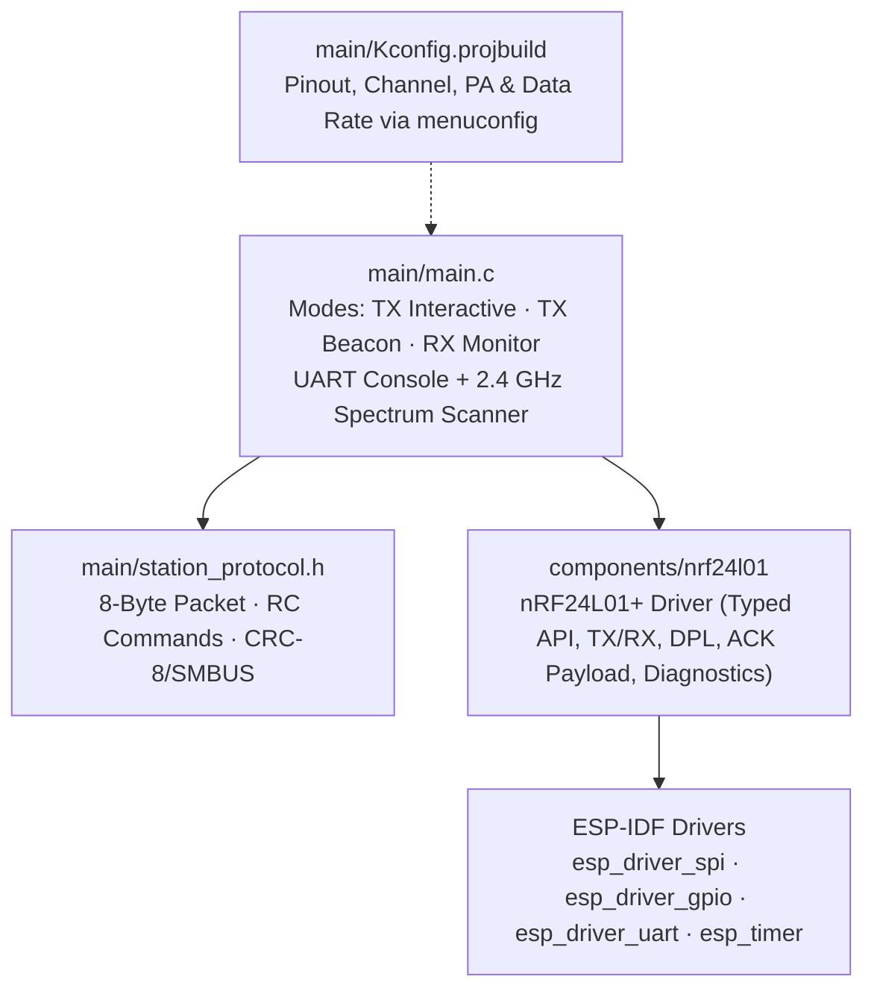

# 📡 ESP32 Station — nRF24L01+ Driver & RF Base Station

<p align="center">
  <strong>🇺🇸 English</strong> · <a href="README.pt-BR.md">🇧🇷 Português</a>
</p>

<p align="center">
  
  
  
  
  
</p>

> **ESP32 + nRF24L01+ wireless base station firmware in C (ESP-IDF)** featuring a complete datasheet-compliant driver component, a CRC-8 binary framing protocol, an interactive serial console, a 2.4 GHz RF spectrum scanner, and a host-side unit test suite.

---

## 📑 Table of Contents

- [Overview](#-overview)
- [System Architecture](#-system-architecture)
- [Hardware & Pinout](#-hardware--pinout)
- [Repository Structure](#-repository-structure)
- [Operating Modes](#-operating-modes)
- [Build & Flash Guide](#-build--flash-guide)
- [Interactive Console & RF Scanner](#-interactive-console--rf-scanner)
- [Unit Tests (Host / Mock SPI)](#-unit-tests-host--mock-spi)
- [Detailed Technical Documentation](#-detailed-technical-documentation)
- [Troubleshooting](#-troubleshooting)
- [License](#-license)

---

## 🎯 Overview

**ESP32 Station** is a modular **ESP-IDF** firmware that provides:

1. **Complete, datasheet-compliant `nrf24l01` driver component** ([`components/nrf24l01`](components/nrf24l01)):
   - **Single full-duplex SPI transactions** with hardware-managed `CSN` (no mid-command chip-select glitches).
   - Full **Enhanced ShockBurst** support (Auto-ACK, configurable retries, 6 RX pipes, dynamic payloads, and ACK payloads).
   - Strongly typed enums for air data rate (`250 kbps`, `1 Mbps`, `2 Mbps`), PA output power (`-18` to `0 dBm`), hardware CRC, and address width.
   - Built-in hardware self-check (`nrf24_is_connected`), link statistics (`TX_OK`, `MAX_RT`, `TIMEOUT`, `RX`), `OBSERVE_TX` telemetry, and carrier detection (`RPD`).
2. **Structured binary communication protocol** ([`main/station_protocol.h`](main/station_protocol.h)):
   - Compact **8-byte** frames with sync header (`0xA5`), protocol version, sequence counter (`seq`) for loss detection, and **CRC-8/SMBUS** integrity check.
3. **`menuconfig`-driven application** ([`main/Kconfig.projbuild`](main/Kconfig.projbuild)):
   - Three ready-to-use modes: **TX Interactive (RC + RF Scanner)**, **TX Periodic Beacon**, and **RX Monitor**.

---

## 🏗️ System Architecture

### Physical & RF Link



### Software Layers



---

## 🔌 Hardware & Pinout

Default wiring (customizable via `idf.py menuconfig → ESP32 Station Configuration → Pinagem SPI`):

| nRF24L01+ Pin | Default ESP32 Pin | Function | Notes |
| :---: | :---: | :--- | :--- |
| **VCC** | `3V3` | 3.3 V Power | **Never connect to 5 V!** Place a `10 µF` + `100 nF` decoupling capacitor right at the module |
| **GND** | `GND` | Common Ground | Keep jumper wires short |
| **CE** | `GPIO 4` | Chip Enable (TX/RX) | Driven via GPIO by the driver |
| **CSN** | `GPIO 5` | SPI Chip Select (active low) | Managed automatically by the `SPI2` peripheral |
| **SCK** | `GPIO 18` | SPI Clock (VSPI/SPI2) | Default `1 MHz` (supports up to `10 MHz`) |
| **MOSI** | `GPIO 23` | Master Out Slave In | ESP32 → nRF24L01+ data |
| **MISO** | `GPIO 19` | Master In Slave Out | nRF24L01+ → ESP32 data |
| **IRQ** | `Unconnected (-1)` | Interrupt (active low) | Optional — configurable via `menuconfig` |

> [!WARNING]
> **Power rail stability:** nRF24L01+ modules (especially **PA+LNA** variants) draw sharp current spikes during transmission that can brown out weak 3.3 V regulators. Solder a **10 µF** (or 47 µF) electrolytic capacitor in parallel with a **100 nF** ceramic capacitor directly across the module's **VCC** and **GND** pins.

See [docs/HARDWARE.md](docs/HARDWARE.md) for wiring diagrams, SPI timing specs, and the complete register map.

---

## 📁 Repository Structure

```text
esp32-station/
├── .github/workflows/             # Automated CI (strict C11 build + unit tests)
├── components/
│   └── nrf24l01/
│       ├── CMakeLists.txt
│       ├── include/nrf24l01.h     # Public API, enums, structs & register map
│       └── src/nrf24l01.c         # SPI/RF driver implementation
├── docs/
│   ├── API.md                     # Driver API reference (English)
│   ├── HARDWARE.md                # Electrical guide, SPI timing & registers (English)
│   ├── PROTOCOL.md                # Binary protocol & ESB flow (English)
│   └── pt-BR/                     # Complete Portuguese documentation (API, HARDWARE, PROTOCOL)
├── main/
│   ├── CMakeLists.txt
│   ├── Kconfig.projbuild          # idf.py menuconfig options
│   ├── station_protocol.h         # 8-byte packet, commands & CRC-8
│   └── main.c                     # Application (TX Interactive, TX Beacon, RX Monitor)
├── test/
│   ├── Makefile                   # One-command host unit test runner
│   ├── mocks/                     # Minimal ESP-IDF header mocks for host builds
│   ├── mock_nrf24_hw.h/.c         # Stateful virtual nRF24L01+ hardware simulator
│   └── test_nrf24l01.c            # Unit test suite (driver + protocol)
├── CMakeLists.txt
├── LICENSE
├── README.md                      # Main documentation (English)
└── README.pt-BR.md                # Main documentation (Português)
```

---

## ⚙️ Operating Modes

Select the board role in `idf.py menuconfig → ESP32 Station (nRF24L01+) Configuration`:

| Mode (`Kconfig`) | Description | Use Case |
| :--- | :--- | :--- |
| **`TX Interactive`** *(default)* | Reads keyboard commands over UART0, transmits packets with Auto-ACK, measures RTT (`P`), and runs a 2.4 GHz channel scanner (`C`) | RC rover control & benchtop RF diagnostics |
| **`TX Periodic Beacon`** | Periodically transmits `STATION_CMD_BEACON` frames and reports live delivery rate (%) | Range testing, antenna evaluation & link stability checks |
| **`RX Monitor`** | Continuously listens on Pipe 0, validates `magic` + `CRC-8`, tracks dropped packets via `seq`, and logs decoded telemetry | Second ESP32 acting as receiver or packet sniffer |

---

## 🚀 Build & Flash Guide

### Prerequisites

- **ESP-IDF v5.3 or newer** installed and configured in your environment (`idf.py` in `PATH`).

### Step-by-step

```bash
# 1. Clone the repository
git clone https://github.com/Paludeto/esp32-station.git
cd esp32-station

# 2. Set the target MCU
idf.py set-target esp32

# 3. (Optional) Configure TX/RX mode, RF channel, pins, and PA level
idf.py menuconfig

# 4. Build the firmware
idf.py build

# 5. Flash and open the serial monitor (replace COM3 or /dev/ttyUSB0)
idf.py -p COM3 flash monitor
```

> [!TIP]
> The default channel is **2 (2402 MHz)** with address `00:00:00:00:01` for backwards compatibility with existing receivers. In noisy Wi-Fi environments, change `STATION_RF_CHANNEL` to a channel between **76 and 125** (`2476–2525 MHz`) — use the `C` command in the interactive console to find the quietest channel!

---

## 🖥️ Interactive Console & RF Scanner

In **TX Interactive** mode, connect to the serial monitor (`115200 bps`) and use these keys:

| Key | Action | Behavior / Packet Sent |
| :---: | :--- | :--- |
| `W` / `S` / `A` / `D` | Forward / Backward / Left / Right | Sends `STATION_CMD_*` with the current `speed` |
| `X` | Stop (`STOP`) | Sends `STATION_CMD_STOP` with `speed = 0` |
| `+` / `-` | Increase / Decrease speed | Adjusts `speed` (`0..255`) in steps of `25` |
| `P` | RF Ping | Sends `STATION_CMD_PING` and measures TX + Auto-ACK RTT in µs |
| `I` | Inspect registers & stats | Prints full register dump, `OBSERVE_TX`, and link counters |
| `C` | **2.4 GHz RF Scanner** | Scans channels `0..125` via `RPD` and suggests the cleanest channel |
| `H` or `?` | Help | Prints the command menu |

### Example Serial Monitor Output

```text
I (312) STATION: Iniciando ESP32 Station (nRF24L01+)...
I (330) NRF24: nRF24L01+ inicializado (CH=2, 2402 MHz, SPI=1000000 Hz)
I (332) NRF24: ================ nRF24L01+ Status ================
I (335) NRF24: STATUS      = 0x0E (RX_DR=0 TX_DS=0 MAX_RT=0 RX_P_NO=7 TX_FULL=0)
I (339) NRF24: CONFIG      = 0x0E (PWR_UP=1 PRIM_RX=0 CRC=2B)
I (343) NRF24: RF_CH       = 2 (2402 MHz)
I (346) NRF24: RF_SETUP    = 0x06 (Rate=1 Mbps, PA=0 dBm)
I (350) NRF24: TX_ADDR     = 00:00:00:00:01
I (353) NRF24: ==================================================
I (2410) STATION: TX OK -> FORWARD  | seq=0 | speed=180 | 842 us (arc=0)
I (3125) STATION: PONG seq=1 | RTT=796 us | retries=0
```

---

## 🧪 Unit Tests (Host / Mock SPI)

Both the driver and protocol can be compiled and tested **directly on your PC with GCC**, without physical hardware, via the stateful nRF24L01+ simulator in [`test/`](test):

```bash
# Using Make (Linux / macOS / MSYS2)
make -C test

# Or directly with GCC (Windows PowerShell / Bash)
gcc -std=c11 -Wall -Wextra -Werror -Wpedantic \
    -Icomponents/nrf24l01/include -Imain -Itest/mocks -Itest \
    components/nrf24l01/src/nrf24l01.c test/mock_nrf24_hw.c test/test_nrf24l01.c \
    -o test/build/test_nrf24l01 && ./test/build/test_nrf24l01
```

The test suite verifies:
- Init/deinit lifecycle, exclusive hardware SPI `CSN` management, and `Tpd2stby` settling time.
- Disconnected SPI detection (`nrf24_is_connected` when `MISO` is stuck at `0x00` or `0xFF`).
- RF channel bounds (`0..125`), data rate (`250k/1M/2M`), PA level, CRC, address width, and retry registers.
- RX pipe addressing (`P0–P1` 5-byte vs `P2–P5` 1-byte LSB) and automatic `RX_ADDR_P0` restoration across `TX ↔ RX` switches.
- `TX_DS` confirmation, `MAX_RT` recovery (`FLUSH_TX`), timeouts, multi-byte reception, dynamic payloads (including automatic `FLUSH_RX` on corrupt width > 32 bytes), ACK payloads, and protocol **CRC-8** integrity checks.

---

## 📚 Detailed Technical Documentation

| Document | Contents |
| :--- | :--- |
| **[docs/API.md](docs/API.md)** | Complete reference of types, enums, functions, and C usage examples (TX, RX, ACK Payload) |
| **[docs/HARDWARE.md](docs/HARDWARE.md)** | Electrical wiring guide, decoupling tips, datasheet timings, and register map (`0x00`–`0x1D`) |
| **[docs/PROTOCOL.md](docs/PROTOCOL.md)** | Byte-by-byte layout of `station_packet_t`, command table, CRC-8/SMBUS, and ESB sequence diagram |

---

## 🔧 Troubleshooting

| Symptom | Likely Cause | Fix |
| :--- | :--- | :--- |
| `Modulo nRF24L01+ NAO detectado no barramento SPI!` | Swapped `MISO`/`MOSI`, loose `CSN`/`SCK`, or unpowered module | Double-check pinout and measure `3.3 V` directly across module pins |
| `MAX_RT atingido (sem ACK do receptor)` | Receiver powered off, mismatched channel/address, or mismatched `Auto-ACK` | Verify matching channel (`RF_CH`), air rate (`RF_SETUP`), payload size (`8 B`), and address `00:00:00:00:01` on both ends |
| Very short range or intermittent drops | Wi-Fi interference on channel 2 or noisy 3.3 V rail | Add `10 µF + 100 nF` decoupling caps on `VCC`/`GND` and run the scanner (`C`) to pick a clean channel `>= 76` |
| PA+LNA module fails at close range | Receiver front-end saturation at `0 dBm` when antennas are inches apart | Separate modules (> 1 m) or lower output power to `NRF24_PA_MIN` / `NRF24_PA_LOW` during bench tests |

---

## 📄 License

Distributed under the **MIT License**. See [LICENSE](LICENSE) for details.
