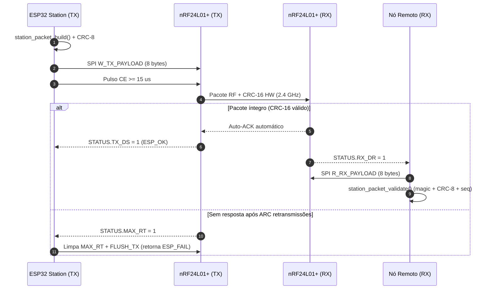

# 📦 Especificação do Protocolo — `station_protocol.h`

O firmware utiliza um quadro binário compacto de **8 bytes** ([`main/station_protocol.h`](../main/station_protocol.h)) sobre o protocolo **Enhanced ShockBurst** do nRF24L01+.

---

## 1. Estrutura do Pacote (`station_packet_t`)

| Offset | Campo | Tipo | Tamanho | Descrição |
| :---: | :--- | :---: | :---: | :--- |
| `0` | `magic` | `uint8_t` | 1 byte | Identificador fixo de quadro: **`0xA5`** |
| `1` | `version` | `uint8_t` | 1 byte | Versão do protocolo: **`0x01`** |
| `2` | `cmd` | `uint8_t` | 1 byte | Código do comando (`station_cmd_t`) |
| `3` | `speed` | `uint8_t` | 1 byte | Intensidade / duty-cycle PWM (`0..255`) |
| `4..5` | `seq` | `uint16_t` | 2 bytes | Contador sequencial *(little-endian)* para detecção de perdas |
| `6` | `flags` | `uint8_t` | 1 byte | Bits auxiliares reservados para expansões futuras |
| `7` | `crc8` | `uint8_t` | 1 byte | **CRC-8/SMBUS** (polinômio `0x07`, init `0x00`) sobre os bytes `0..6` |

> **Tamanho total:** `8 bytes` verificados em tempo de compilação por `_Static_assert(sizeof(station_packet_t) == 8U)`.

---

## 2. Tabela de Comandos (`station_cmd_t`)

| Código (Hex) | Enum | Tecla (Console) | Significado |
| :---: | :--- | :---: | :--- |
| `0x00` | `STATION_CMD_STOP` | `X` | Parada imediata / estado seguro (`speed = 0`) |
| `0x01` | `STATION_CMD_FORWARD` | `W` | Movimento para frente |
| `0x02` | `STATION_CMD_BACKWARD` | `S` | Movimento em ré |
| `0x03` | `STATION_CMD_LEFT` | `A` | Giro à esquerda |
| `0x04` | `STATION_CMD_RIGHT` | `D` | Giro à direita |
| `0x10` | `STATION_CMD_PING` | `P` | Teste de conectividade e medição de RTT |
| `0x20` | `STATION_CMD_BEACON` | *(automático)* | Heartbeat periódico (modo `TX Beacon`) |

---

## 3. Fluxo de Comunicação (Enhanced ShockBurst)

---

## 4. Algoritmo CRC-8/SMBUS

O byte `crc8` garante proteção adicional ponta a ponta (inclusive contra corrupção no barramento SPI):
- **Polinômio:** $x^8 + x^2 + x + 1$ (`0x07`)
- **Valor inicial:** `0x00`
- **Entrada:** bytes `0..6` de `station_packet_t`
- **Validação:** `station_packet_validate(&pkt)` retorna `true` apenas se `magic == 0xA5`, `version == 0x01` e `crc8 == station_crc8(pkt, 7)`.
