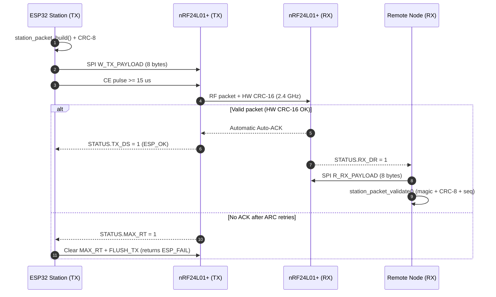

# 📦 Protocol Specification — `station_protocol.h`

> [🇧🇷 Português](../PROTOCOL.md) · **🇺🇸 English**

The firmware exchanges a compact **8-byte** binary frame ([`main/station_protocol.h`](../../main/station_protocol.h)) over the nRF24L01+ **Enhanced ShockBurst** link layer.

---

## 1. Packet Layout (`station_packet_t`)

| Offset | Field | Type | Size | Description |
| :---: | :--- | :---: | :---: | :--- |
| `0` | `magic` | `uint8_t` | 1 byte | Fixed frame sync byte: **`0xA5`** |
| `1` | `version` | `uint8_t` | 1 byte | Protocol version: **`0x01`** |
| `2` | `cmd` | `uint8_t` | 1 byte | Command code (`station_cmd_t`) |
| `3` | `speed` | `uint8_t` | 1 byte | Intensity / PWM duty cycle (`0..255`) |
| `4..5` | `seq` | `uint16_t` | 2 bytes | Sequential counter *(little-endian)* for packet-loss detection |
| `6` | `flags` | `uint8_t` | 1 byte | Reserved status/telemetry bitfield for future extensions |
| `7` | `crc8` | `uint8_t` | 1 byte | **CRC-8/SMBUS** (polynomial `0x07`, init `0x00`) over bytes `0..6` |

> **Total size:** `8 bytes`, enforced at compile time via `_Static_assert(sizeof(station_packet_t) == 8U)`.

---

## 2. Command Codes (`station_cmd_t`)

| Code (Hex) | Enum | Console Key | Meaning |
| :---: | :--- | :---: | :--- |
| `0x00` | `STATION_CMD_STOP` | `X` | Immediate stop / safe state (`speed = 0`) |
| `0x01` | `STATION_CMD_FORWARD` | `W` | Move forward |
| `0x02` | `STATION_CMD_BACKWARD` | `S` | Move backward / reverse |
| `0x03` | `STATION_CMD_LEFT` | `A` | Turn left |
| `0x04` | `STATION_CMD_RIGHT` | `D` | Turn right |
| `0x10` | `STATION_CMD_PING` | `P` | Connectivity & RTT latency probe |
| `0x20` | `STATION_CMD_BEACON` | *(automatic)* | Periodic heartbeat (`TX Beacon` mode) |

---

## 3. Enhanced ShockBurst Communication Flow

---

## 4. CRC-8/SMBUS Checksum

The trailing `crc8` byte provides end-to-end integrity verification (including protection against SPI bus corruption):
- **Polynomial:** $x^8 + x^2 + x + 1$ (`0x07`)
- **Initial value:** `0x00`
- **Input:** bytes `0..6` of `station_packet_t`
- **Validation:** `station_packet_validate(&pkt)` returns `true` only if `magic == 0xA5`, `version == 0x01`, and `crc8 == station_crc8(pkt, 7)`.
